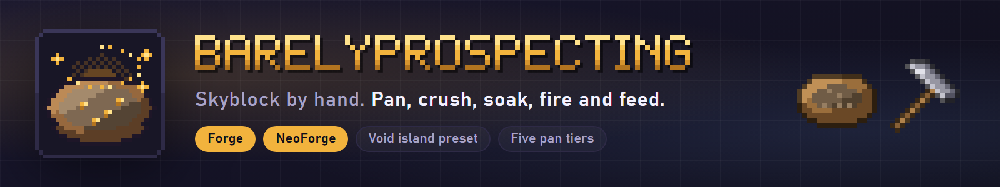

**A hands-on skyblock for Forge and NeoForge: pan silt, crush rubble, soak, fire a crucible and feed a lure, from a bare void island to the End.**

Every step is a hand on a block. You hammer, you hold a tray until a ring closes, you drop an item in a basin and wait, you feed a fire, you feed a lure. Nothing runs on its own, and every result feeds the next step: dirt becomes silt, stone becomes rubble, then grit, then fine grit, and every stage can be panned again for finer finds.

Docs and the numbers: [itmecasey.com/wiki/barelyprospecting](https://itmecasey.com/wiki/barelyprospecting/)

- **Scrounge:** break leaves and dirt bare-handed for twigs and pebbles, and craft a pick-hammer and a panning tray from them.
- **Hammer:** one blow, one step down the chain, and the block changes under your hand.
- **Pan:** hold a tray on silt or grit and a ring of sparks closes around the block. Blocks wear in four visible stages.
- **Basin:** fill it with a bucket or let rain do it, drop an item in, wait, take the result. Silt turns into clay.
- **Crucible:** feed it fuel and rubble by hand. Take lava in a clay bucket, or quench it for stone and obsidian.
- **Lure:** three offerings of bait, a short wait, and something answers with string, bone, gunpowder or an ender pearl.
- **Void Island world type:** a small island, one tree and a starter chest, built the first time the world starts.
- **ModJS scripting:** with ModJS, scripts can listen to panning, hammering, soaking, the crucible and the lure, read the state of a block, and add, replace or remove drop rows and rules.
- **Shared and server friendly:** basins, crucibles and lures keep their state in the block, so a whole team uses the same ones.

1. Break leaves and dirt for twigs and pebbles. Craft a pick-hammer and a wooden panning tray.
2. Hammer dirt into silt and pan it: seeds, saplings, flint, coal dust. Grow a tree, then grow more.
3. Hammer stone into rubble and grit. Pan the grit with the wooden tray for the first copper.
4. Soak silt in a basin for clay. Fire a clay bucket and a crucible. Melt rubble into lava, stone and obsidian.
5. Upgrade the tray, one metal at a time. Feed a lure for the things only a mob drops.
6. Build the portal. Nether silt and End silt are new materials with new finds, up to diamonds and netherite scrap.

Five trays: wooden, copper, iron, gold and diamond. Each is the last one plus four flakes of the metal it found, rolls faster, rolls more often and unlocks rarer rows in the drop tables. They are the gates between the phases.

Needs no other mod. Optional extras: panning, hammering, soaking, melting and lure pages in **BEI, JEI, REI and EMI**, and look-at info on basins, crucibles, lures and silt in **SMWTI and Jade**, on every build where that mod exists. The wiki lists which.

**Can I change the numbers?** The config file scales every drop (`dropMultiplier`), has a fast mode for modpacks that makes every wait four times shorter, and sets the ring length and how many pans a block gives.

**Is the balance final?** No, it is a first pass.

**Source and issues:** [github.com/ItMeCasey/BarelyProspecting](https://github.com/ItMeCasey/BarelyProspecting)
